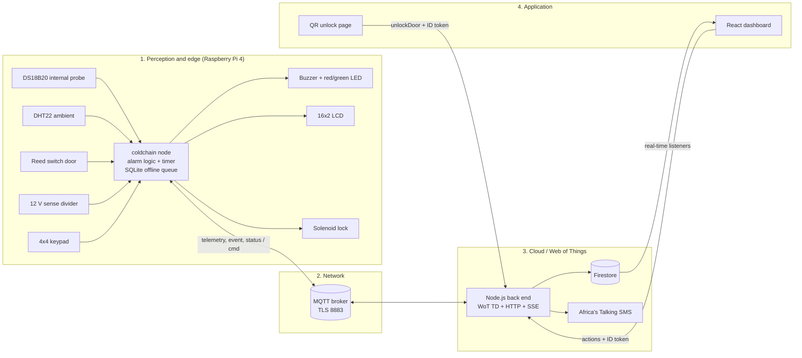

# Architecture

Four layers. **All alarm logic runs on the edge node**, so the buzzer, LED and LCD keep working without Internet.

## Data flow

1. The node reads the sensors every ~2 s, runs the alarm state machine and drives the local outputs.
2. It publishes telemetry (every 30 s or on a 0.2 °C change), events and a retained `online` status.
   If the broker is unreachable, messages go into a SQLite queue and are sent in order later.
3. The back end subscribes, keeps the latest state in memory (for the WoT property reads), writes to
   Firestore, pushes events to SSE clients and decides on SMS.
4. The dashboard reads Firestore directly with real-time listeners. It calls the back end only for
   actions, with a Firebase ID token.
5. Actions become MQTT commands with an ID, a 30 s expiry and an HMAC signature. The node replies
   on `cmd/result`, and the back end returns that result in the HTTP response.

## What still works when

| Failure | Local alarm | Dashboard | SMS |
|---|---|---|---|
| Internet / Wi-Fi down | yes | shows OFFLINE after LWT or 2 min silence | "offline" SMS from the back end |
| Mains (12 V) cut | yes (Pi on UPS) | yes, if the Wi-Fi router is still powered | yes |
| Back end down | yes | shows stale data ("last updated" grows) | no |
| Pi off / crashed | no | OFFLINE (LWT) | "offline" SMS |

Known limit: SMS goes out from the cloud, so a site with no Internet gets no SMS. A GSM module
(e.g. SIM800) on the node would fix this; it is future work, not in scope.
